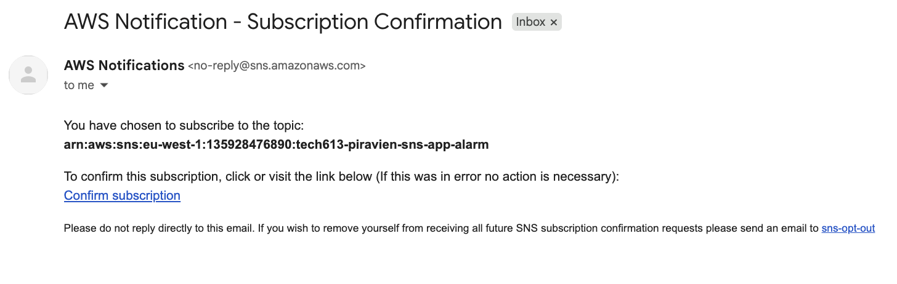
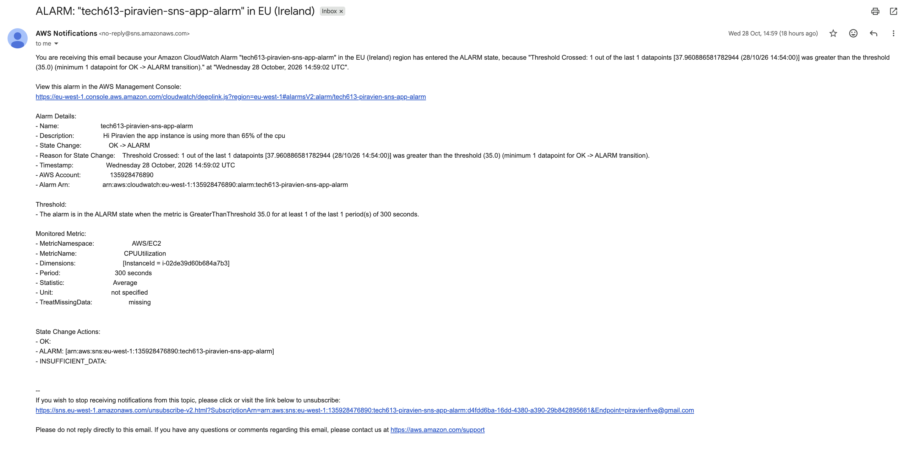

# AWS Monitoring

## 1. Why We Need Monitoring

Monitoring helps us check if our EC2 instance is working correctly.

It helps us:
- Find problems early.
- Monitor CPU usage.
- Check application performance.
- Receive alerts when something goes wrong.

### Worst to Best Monitoring

1. **Worst:** Users report that the app is broken.
2. **Better:** We notice the problem ourselves.
3. **Good:** CloudWatch sends us an alert.
4. **Best:** We prevent problems before users are affected.

### Diagram

```text
WORST                         BEST

Users report a problem
          |
We notice the problem
          |
CloudWatch sends an alert
          |
We prevent the problem
```

## 2. CloudWatch Dashboard

### Delete Old Dashboard

1. Open AWS Console.
2. Go to CloudWatch.
3. Select Dashboards.
4. Select the old dashboard.
5. Click Delete.


### Create New Dashboard

1. Go to CloudWatch > Dashboards.
2. Click Create dashboard.
3. Name it `EC2-Monitoring`.
4. Add a Line widget.
5. Select EC2 > Per-Instance Metrics.
6. Select CPUUtilization for the app instance.
7. Save the dashboard.

### Enable Detailed Monitoring

1. Go to EC2 > Instances.
2. Select the app instance.
3. Click Actions > Monitor and troubleshoot.
4. Select Manage detailed monitoring.
5. Enable detailed monitoring.
6. Save.

Detailed monitoring collects metrics every 1 minute instead of every 5 minutes. It costs extra.

## 3. Apache Bench Load Testing

Apache Bench sends lots of requests to our app to test its performance.

### Install Apache Bench

SSH into the app EC2 instance.

```bash
sudo apt-get update
sudo apt-get install -y apache2-utils
```

### Run Load Test

```bash
ab -n 10000 -c 100 http://localhost/
```

- `-n 10000` means 10,000 requests.
- `-c 100` means 100 requests at the same time.

### Check CPU Usage

1. Open CloudWatch.
2. Open the EC2 dashboard.
3. Check the CPUUtilization graph.
4. Look for a CPU spike during the load test.


## 4. Create a CPU Alarm

CloudWatch can send an email when CPU usage is too high.

### Create Alarm

1. Go to CloudWatch > Alarms > All alarms.
2. Click Create alarm.
3. Click Select metric.
4. Choose EC2 > Per-Instance Metrics.
5. Select CPUUtilization for the app instance.
6. Set threshold to Greater than 30%.
7. Set period to 1 minute.
8. Set 2 consecutive periods.
9. Create a new SNS topic.
10. Enter your email address.
11. Name the alarm.
12. Create the alarm.

### Confirm Email Subscription

1. Open email
2. Find the AWS SNS confirmation email.
3. Click Confirm subscription.



## 5. Test the Alarm

Run another load test:

```bash
ab -n 100000 -c 100 http://localhost/
```

1. Open CloudWatch > Alarms.
2. Check if the alarm changes to `In alarm`.
3. Check your inbox for the alert email.

The load test may need to run longer to keep CPU usage above 50%.



## 6. Conclusion

I used AWS CloudWatch to monitor EC2 CPU usage.

I recreated a dashboard, enabled detailed monitoring, tested the app with Apache Bench, and configured a CPU alarm to send email notifications.